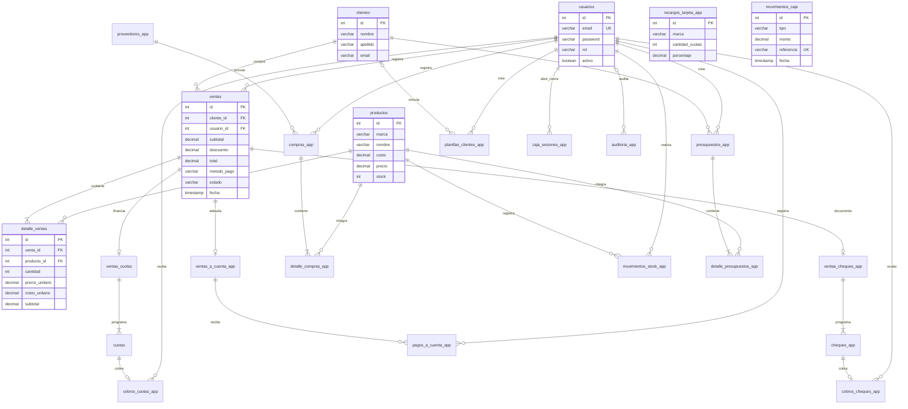

# Modelo entidad-relación

El esquema completo y ejecutable está en `database/schema.sql`. Las entidades se separan por su responsabilidad; los detalles representan relaciones entre documentos y productos. Los planes de financiamiento y sus cobros no se almacenan dentro de la tabla cliente o producto.

## Integridad y decisiones del modelo

- Cada tabla tiene una clave primaria numérica. Ventas, compras, presupuestos y sus detalles referencian las entidades con claves foráneas; los detalles tienen cantidades positivas y valores monetarios no negativos.
- La relación venta/plan es uno a cero-o-uno: la FK de cada plan es UNIQUE. Los cobros de cuota/cheque también son únicos para impedir duplicados.
- La combinación plan/número de cuota o cheque es única. Una columna calculada única impide abrir dos sesiones de caja simultáneas.
- Los detalles guardan el precio y costo históricos del documento. Cambiar el catálogo no altera la valuación de ventas anteriores. Los totales/subtotales son valores de cierre conservados junto con la operación.
- La marca del producto es un atributo textual simple; no se repiten datos completos del producto en los detalles. Los datos completos de cliente y usuario se consultan por FK.
- Stock y saldo son acumulados mantenidos en transacciones. El procedimiento usa SELECT FOR UPDATE para bloquear los productos y evitar ventas por encima del stock disponible.
- `movimientos_caja.referencia` contiene una referencia única al origen de cada asiento (venta, cuota, cheque, entrega o reversión). Es un registro de caja con distintos tipos de origen; no representa una FK polimórfica validada por MySQL. Los servicios crean los asientos dentro de la misma transacción del documento.
- El JSON de planillas representa una grilla editable de texto, separada de los registros normalizados del negocio. No sustituye las relaciones de ventas, clientes o productos.
- Las anulaciones y archivos son cambios de estado. Se conserva el historial de documentos y comprobantes; las FK restringen las bajas que lo romperían.
