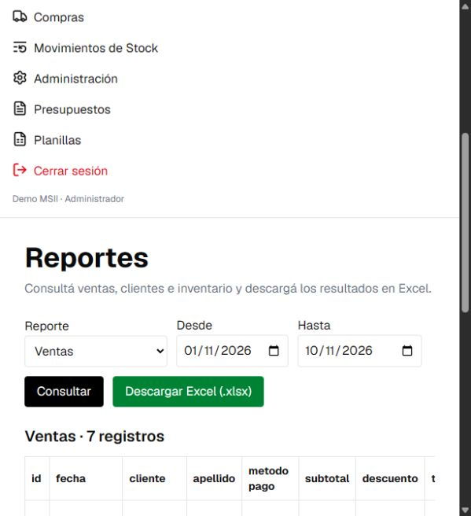

# Verificación de la adaptación

Fecha: 10 de noviembre de 2026.

## Resultado

- 17 casos de prueba aprobados en `backend/tests/test_integration.py`.
- Suite ejecutada con MySQL Community Server 9.7.2 instalado en este equipo, en una instancia independiente enlazada a 127.0.0.1:33307, con datos dentro de `work/` y base exclusiva `msii_test`.
- Inicialización del esquema desde cero y creación del procedimiento ejecutadas correctamente. La segunda inicialización también se comprobó para verificar la inserción idempotente de cuentas y configuraciones.
- Frontend: `npm run lint` y `npm run build` ejecutados correctamente.
- `npm audit --omit=dev`: cero vulnerabilidades en las dependencias de producción. La auditoría completa informa seis avisos en herramientas de desarrollo (dos bajos y cuatro moderados, dependencias transitivas del CLI shadcn); no se distribuyen como servidor Node ni se ejecutan en la aplicación Python de producción.
- Prueba en navegador sobre FastAPI sirviendo la compilación React: login de una cuenta de demostración, dashboard con métricas reales de MySQL y pantalla de reportes con resultados. Se accionó la descarga `.xlsx` y no se registraron errores en la consola del navegador.
- La suite abre los archivos XLSX devueltos por las cuatro consultas con openpyxl y comprueba que contienen datos. También comprueba que un nombre que empieza por `=` se exporta como texto y no como fórmula.

## Casos cubiertos

1. Autenticación, JWT vencido, contraseñas incorrectas, roles y revocación por usuario inactivo.
2. CRUD de productos/clientes, datos inválidos y eliminación de registros sin operaciones.
3. Venta con COMMIT; errores de stock y descuento con ROLLBACK, incluso tras modificaciones parciales dentro del procedimiento.
4. Edición y anulación con restauración de stock y reversión de caja; rechazo de una segunda anulación.
5. Dos ventas concurrentes: solo una logra consumir el stock disponible.
6. Ventas en cuotas, cuotas efectivo, cheques y cuenta corriente; pagos, comprobantes y archivo solo cuando no hay pendientes.
7. Compras, presupuestos sin afectación del stock, planillas, métricas, estadísticas y reportes.
8. Apertura/cierre de caja y rechazo de aperturas o cierres duplicados.
9. Edición de los cuatro tipos de financiamiento antes de cobros posteriores.
10. Entrega de un cliente distribuida entre dos ventas y comprobante agrupado.
11. Dos cobros concurrentes de la misma cuota: un único cobro y un rechazo por conflicto.

## Límites de la verificación

El equipo no tiene Docker disponible, por lo que no se ejecutó `docker compose up` ni el contenedor MySQL 8.4. El Dockerfile y Compose quedan preparados para ese despliegue; las pruebas reales de SQL y API se realizaron con MySQL 9.7.2 y Python 3.11. La versión de Python del contenedor es 3.12.

No se importaron datos reales de PostgreSQL ni se publicaron cambios en GitHub. La rama local es `adaptacion-msii-2026`.

Las credenciales y datos usados en las pruebas son temporales y no forman parte de la entrega. Configurar las propias cuentas en `.env` antes de utilizar el proyecto.

## Evidencia visual

